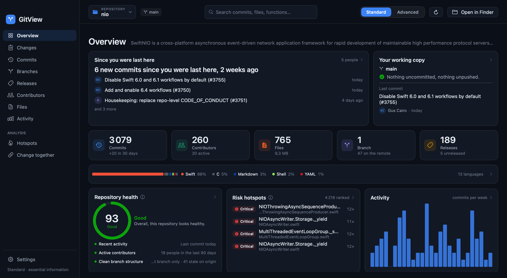

<div align="center">

# GitView

**Understand any repository. Faster.**

A native macOS app that reads a project's git history and tells you what changed,
who to ask about it, and which code is most likely to bite you.




</div>

## What it is

Open a repository and GitView answers the questions you actually have about it.

**What happened while I was away?** It remembers when you last looked and shows you what
landed since — whose commits, which files, and which of them touched code you have worked
on yourself (matching both your configured git name and email).

**What have I got going on right now?** Uncommitted edits, untracked file previews, staged
changes, per-hunk staging/unstaging/discarding, unpushed commits, stashes, and interrupted
merges or rebases. Fetch remotes, fast-forward pull, switch or create branches, commit,
stash, and push directly from the app.

**Who do I ask about this file?** Ownership per file and per folder, with the knowledge
risk when only one person has ever touched something.

**What changed between these two versions?** Any two tags, branches or commits, with
release notes you can copy into a changelog and syntax-highlighted unified or side-by-side
diffs featuring inline word-level change emphasis and find-in-diff.

**Where is this project likely to break?** Functions ranked by how complicated they are
*and* how often they change — the combination, not either alone. Plus the functions that
keep being edited in the same commit as each other, which is where a change in one and a
forgotten change in the other turns into a bug.

It works on any git repository on your disk. Nothing is uploaded, there is no account, and
there is no telemetry; the only remote network calls happen when you explicitly ask to
fetch, pull, or push.

## Install

No release binary yet — build it from source. You need a Swift 6 toolchain (Xcode 16 or
newer; built and tested here on Swift 6.2).

```bash
git clone git@github.com:ShortPlanet3058/gitview.git
cd gitview
Scripts/make-app.sh --universal
cp -r build/GitView.app /Applications/
```

`--universal` builds for Apple Silicon and Intel; drop it to build only for this machine
and halve the build time. The first build compiles fifteen tree-sitter grammars and takes
a few minutes.

## Around the app

| | |
|---|---|
| **Overview** | Plain-language everyday summary (**Standard**) or full project telemetry, health checks, hotspots, and weekly sparklines (**Advanced**). |
| **Changes** | Resizable split workspace pairing a filterable file list & commit dock (Amend, Undo last commit, `⌘⏎`, `Space` stage toggle) with a live unified or side-by-side diff viewer (`-w` whitespace toggle, hunk jumping, visual PNG/image diffs, and per-block conflict resolution). |
| **History / Commits** | Clean chronological history (**Standard**) or interactive swimlane branch topology with a **Current branch / All branches** scope toggle, branch/tag badges, Revert, Cherry-pick, and parent navigation (**Advanced**). |
| **Branches** | Switch, create, rename, compare, and merge branches cleanly (**Standard**), or inspect remote-tracking branches, rebase onto target, force-delete unmerged branches, linked worktrees, and ahead/behind divergence (**Advanced**). |
| **Releases** *(Advanced)* | Create, push, and delete tags, track unreleased commits, and compare any two refs or commits with inline word diffs. |
| **People / Contributors** | See everyone who contributes (**Standard**), plus ownership concentration insights and CSV export (**Advanced**). |
| **Files** | Interactive file tree, syntax-highlighted code viewer, and in Advanced mode line-by-line historical blame & function risk badges. |
| **Activity** *(Advanced)* | Commits over time and the files that change most. |
| **Hotspots** *(Advanced)* | Functions ranked by complexity and recent change frequency, with syntax-highlighted source excerpts. |
| **Change together** *(Advanced)* | Interactive coupling graph with directory cluster hulls, draggable/pinnable nodes, and shared-commit edge inspection. |
| **Statistics** *(Advanced)* | Transparent breakdown of health checks, risk weighting, and hunk attribution coverage. |

Use **Command Palette (`⌘K`)** to jump across screens, files, branches, or actions, and press **`⌘/`** anytime for the full Keyboard Shortcuts overlay; press **`⌘F`** for contextual local find inside the active screen or diff (including the embedded Changes diff) and **`⌘⇧F`** for repository-wide search. **Standard mode** skips unnecessary tree-sitter AST parsing at launch for fast everyday Git workflows without technical jargon, while **Advanced mode** (`⌘⇧D` or the sidebar toggle) hydrates function-level telemetry on demand and unlocks staging power tools, historical blame, swimlane topology, and hotspots. Drop any folder onto a window, or clone/create a new repository right from Welcome or the `File` menu.

## How it works

**Git is read by running git.** Every fact comes from `git` itself through `Process` —
`log`, `status`, `blame`, `rev-list`, `grep`, and a persistent `git cat-file --batch`
streamer for historical source snapshots — rather than a reimplementation of the object
format. If git says it, GitView says it.

**Code is parsed and highlighted with tree-sitter.** Fifteen languages get function-level
complexity analysis and CST syntax highlighting across diffs and source excerpts: C, C#,
C++, CSS, Go, Java, JavaScript, Kotlin, PHP, Python, Ruby, Rust, Swift, TypeScript and TSX.
Every other language is still counted, sized and attributed — it just is not ranked by
function.

**Risk is complexity × recent change.** A function's branch points multiplied by a
time-decayed count of the commits that touched it, with a 365-day half-life. Both sides are
log-damped so one enormous switch statement cannot dominate the ranking. The half-life is a
measured default, not a guess: at the 90 days originally planned, most functions had at most
two commits in the window and the ranking correlated with nothing.

**Analyses are persisted in a local SQLite WAL cache.** A repository is read once into
normalized SQLite tables with per-file `(bytes, mtime)` source unit entries; afterwards
only new commits are appended, and untouched files skip tree-sitter re-parsing entirely.
If history is rewritten, the cache resets automatically rather than silently trusting stale SHAs.

**It notices when the repository moves.** A watch on `.git` picks up a commit made in a
terminal, a pull, or a checkout, and brings the view up to date — unless you are reading a
diff or a file's history, in which case it offers rather than interrupts.

## Writing

GitView can clone and initialize repositories, fetch, pull (fast-forward, or guided rebase/merge when diverged), merge, rebase, cherry-pick, revert commits, undo unpushed commits, amend commits, resolve conflict markers block-by-block, continue or abort interrupted operations, manage tags, switch/rename/create/delete branches, stage/unstage/discard (by file, hunk, or selected lines), stash, and push. The rule it follows is safety and recoverability:

- **Reversible** things — stage, unstage, switch/create/rename branch, fetch, stash, commit, soft-undo unpushed commit, non-published amend — are direct controls.
- **Destructive or history-changing** things — discarding edits, deleting files/branches, reverting commits, merging, rebasing, aborting, resolving conflicts — explain their impact clearly behind confirmation.
- **Push** shows you exactly what will go where before it does anything.

`push --force` and `reset --hard` remain deliberately absent so an accidental click never destroys remote or working-tree history irreversibly.

## Development

```bash
swift build            # build
swift test             # run the test suite
Scripts/make-app.sh    # assemble GitView.app
Scripts/make-icon.swift # regenerate the app icon
```

The package splits cleanly into targets: `GitViewCore` (models, risk analysis, and SQLite WAL cache, no UI),
`GitViewGit` (git CLI wrapper, `cat-file --batch` reader, incremental log/diff parsing), `GitViewParse`
(tree-sitter unit extraction & syntax highlighting), `GitViewUI` (`@Observable` domain stores and SwiftUI views),
plus thin `GitView` app and `gitview-cli` executables. Tests cover parsers, tree-sitter extractors, highlighting,
SQLite caching, UI stores, and real temporary git repositories.

Screens can be rendered offscreen for review without taking over your display:

```bash
build/GitView.app/Contents/MacOS/GitView --repo <path> --screen overview \
  --mode standard --screenshot out.png --screenshot-delay 15 --quit
```

## Known limits

- **macOS only**, and macOS 14 (Sonoma) or newer.
- **Line ranges come from today's checkout** while a commit's hunks refer to the file as it
  was then, so old commits can be attributed to the wrong function. The Statistics tab
  measures this rather than hiding it: roughly 88–100% correct for commits under two years
  old, falling to about 42% beyond five years.
- **The health score is a heuristic** meant to start a conversation, not a verdict. Every
  check shows the number behind it.
- **Merge commits are not counted** by default, deliberately: counting them double-counts
  every change that arrived through one.

## Licence

MIT — see [LICENSE](LICENSE).
